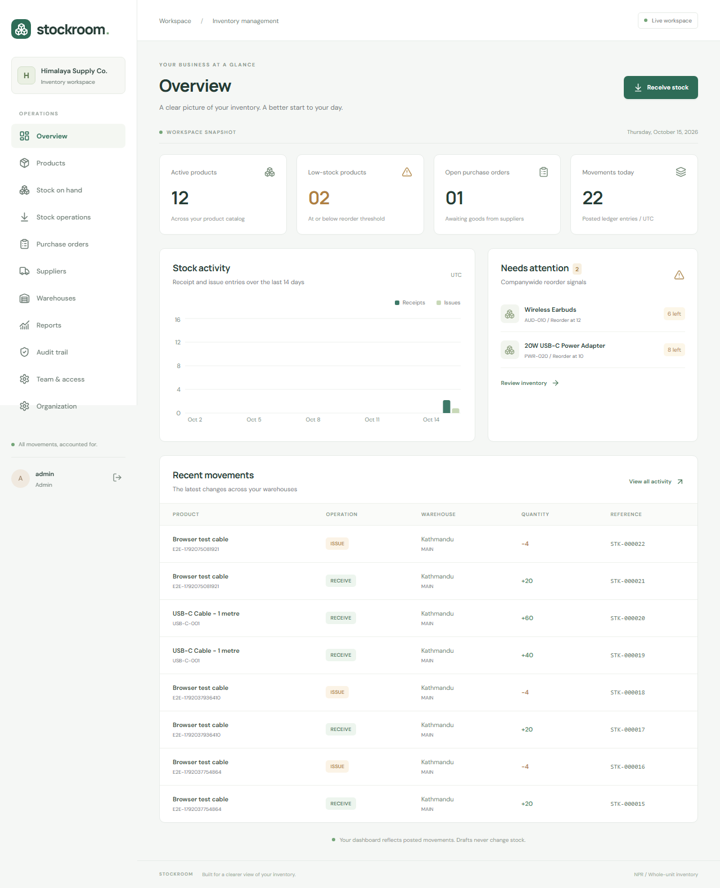

# Stockroom - Inventory Management System

A modular Django/PostgreSQL backend and React/TypeScript workspace implementing the supplied [project blueprint](docs/Inventory_Management_System_Complete_Project_Blueprint.md).



## What it does

- Organization-scoped session authentication, four roles, invitations, password reset, and team administration.
- Products, categories, base units, suppliers, warehouses, and storage bins.
- Draft -> posted receipts, issues, transfers, and adjustments; immutable movement history, nonnegative balances, idempotent posting, and reconciliation.
- Purchase order draft/submission/cancellation/closure and partial goods receipts with over-receipt protection.
- Live dashboard, stock and low-stock reports, movement history, CSV export, and audit trail.
- Responsive interface with role-aware navigation, loading/empty/error states, and posting confirmation.

Inventory quantities are whole numbers. Purchase amounts use decimal arithmetic. **This is an operational inventory system, not a general ledger, tax engine, or certified inventory valuation system.**

## Quick start (PowerShell)

Prerequisites: Python 3.14, Node 24 LTS, Docker Desktop with Linux containers, Git. The lockfiles record exact resolved versions; Django is on the 5.2 LTS line.

```powershell
Copy-Item .env.example .env
docker compose up -d db
python -m venv backend/.venv
backend/.venv/Scripts/python -m pip install -r backend/requirements.txt
backend/.venv/Scripts/python backend/manage.py migrate
# Choose a unique password with at least 12 characters.
$env:ADMIN_PASSWORD = Read-Host 'Initial administrator password'
backend/.venv/Scripts/python backend/manage.py bootstrap --email admin@example.com --demo
Remove-Item Env:ADMIN_PASSWORD
backend/.venv/Scripts/python backend/manage.py runserver 127.0.0.1:8000
```

In another terminal:

```powershell
cd frontend
npm ci
npm run dev
```

Open **http://localhost:5173**, sign in with the bootstrap email and chosen password. API documentation: **http://localhost:8000/api/docs/** after logging in on that origin. Prefer `/api/docs/` through the Vite proxy to share the frontend session. PostgreSQL binds only to loopback on port **55439**; change both Compose and `.env` if occupied.

For Linux/macOS use `backend/.venv/bin/python`, `export ADMIN_PASSWORD=...`, and `unset ADMIN_PASSWORD`. Never commit `.env` or credentials. The seed command is idempotent and posts opening balances through the stock service.

## Docker application

```sh
docker compose up -d --build
docker compose exec backend python manage.py migrate
docker compose exec -e ADMIN_PASSWORD backend python manage.py bootstrap --email admin@example.com --demo
```

Set `ADMIN_PASSWORD` in the invoking shell first. Visit http://localhost:18080. The checked-in Compose file is a **local development configuration**. See [deployment](docs/deployment.md) before exposing it publicly.

## Verification

```powershell
cd backend
.venv/Scripts/python -m pytest -q
.venv/Scripts/python -m ruff check .
.venv/Scripts/python -m ruff format --check .
.venv/Scripts/python manage.py makemigrations --check --dry-run
.venv/Scripts/python manage.py reconcile_inventory
cd ../frontend
npm run build
npm run lint
npm test
npm run test:e2e
```

Backend tests require PostgreSQL and create an isolated `test_inventory` database. Do not point tests at a production database. Browser tests use a dedicated administrator configured through `E2E_USERNAME` and `E2E_PASSWORD`; see [testing](docs/testing.md).

## Project map

```text
backend/apps/accounts/    Identity, memberships, authorization, audit
backend/apps/catalog/     Products, units, categories, suppliers, warehouses
backend/apps/inventory/   Documents, movements, balances, posting services
backend/apps/purchasing/  Orders, receipts, purchase lifecycle
backend/apps/reporting/   Read-only metrics and exports
backend/apps/api/         HTTP contracts, scoped serializers, view orchestration
frontend/src/features/   Feature-level screens and forms
frontend/src/components/ Accessible shared UI and navigation
frontend/src/lib/        HTTP, CSRF, tenant headers, downloads
```

## Documentation

- [Architecture and decisions](docs/architecture.md)
- [Database and invariants](docs/database.md)
- [API contract and examples](docs/api-contract.md)
- [Permissions and authentication](docs/permissions.md)
- [Identity and settings algorithms](docs/algorithms/identity-and-settings.md)
- [Stock posting algorithm](docs/algorithms/stock-posting.md)
- [Idempotency algorithm](docs/algorithms/idempotency.md)
- [Purchasing and partial receipts](docs/algorithms/purchasing.md)
- [Reports, thresholds, reconciliation, and money](docs/algorithms/reporting-and-finance.md)
- [Deployment, backup, restore, and incident handling](docs/deployment.md)
- [Testing and acceptance](docs/testing.md)
- [Blueprint coverage and remaining considerations](docs/implementation-status.md)

Repository: https://github.com/AaronShashankar/Inventory-Management-System
